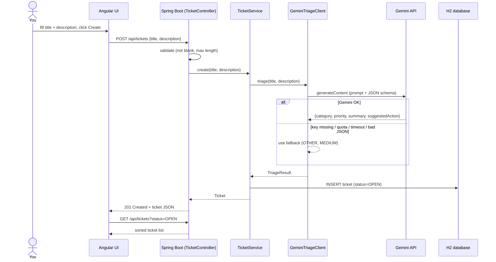
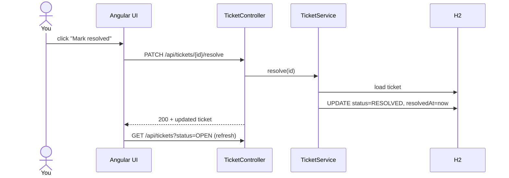
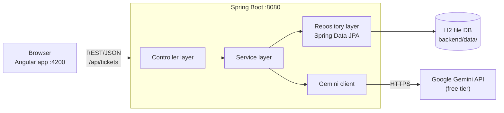
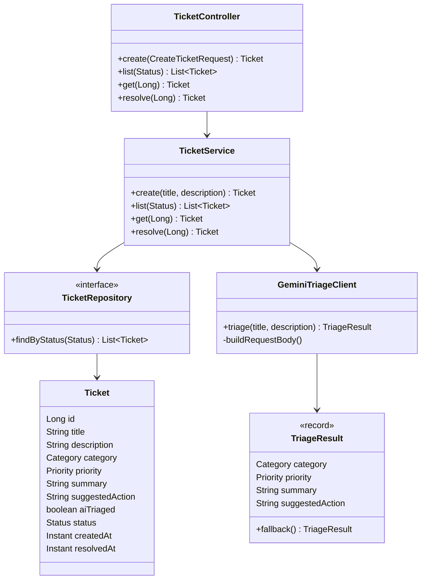

# Ticket Triage: Design

## 1. Requirements

**Functional**
1. Create a ticket (title + description).
2. On creation, AI assigns: category, priority, one-line summary, suggested next action.
3. List tickets (Open / Resolved / All), most urgent first.
4. Mark a ticket as resolved.

**Non-functional**
- One user, no authentication, runs on localhost.
- Free to run (Gemini free tier, embedded H2 database).
- If the AI is down or over quota, ticket creation still works (graceful fallback).
- Small scale: a few tickets a day, so no caching, queues or async jobs.

**Out of scope (on purpose):** login, email, editing/deleting tickets, comments, assignment, attachments.

**Categories:** `BUG, ACCESS_ISSUE, BILLING, FEATURE_REQUEST, HOW_TO, OUTAGE, OTHER`
**Priorities:** `CRITICAL, HIGH, MEDIUM, LOW`

---

## 2. Data flow

### 2.1 Create a ticket



### 2.2 Resolve a ticket



### 2.3 Same thing in plain text

```
Create:   You → Angular form → POST /api/tickets → validate → Gemini (triage)
              → [fallback if Gemini fails] → save to H2 → 201 → UI reloads list
Resolve:  You → button → PATCH /api/tickets/{id}/resolve → status=RESOLVED → UI reloads list
List:     UI → GET /api/tickets?status=... → read H2 → sort (priority, newest) → UI
```

---

## 3. High-Level Design (HLD)



| Component | Responsibility |
|---|---|
| Angular app | Form to add tickets, list with filter tabs, resolve button. Only talks to `/api/tickets`. |
| Controller | HTTP mapping, input validation, JSON in/out, error to status code (404, 400). |
| Service | Business rules: triage on create, sort order, resolve. No HTTP or DB details. |
| Gemini client | Builds the prompt, calls Gemini, parses the result, returns a fallback on any failure. |
| Repository | Persistence via Spring Data JPA. |
| H2 (file mode) | Zero-setup database stored on disk. |

**Key design decisions**

| Decision | Why |
|---|---|
| Triage synchronously inside `POST` | Simple. Gemini Flash answers in 1-3 s, fine for one user. The UI shows "Triaging with AI…". |
| Never fail ticket creation because of AI | The ticket is more important than the label. Fallback values + a "not AI-triaged" badge. |
| Gemini structured output (JSON schema with enums) | Model can only answer with valid category/priority values, so no free-text parsing. |
| Don't hold a DB transaction during the Gemini call | Avoids holding a DB connection while waiting on the network. |
| H2 file DB, no Flyway | Smallest possible setup; `ddl-auto=update` creates the table. |
| Angular dev proxy instead of CORS config | No cross-origin code to write or debug. |
| API key from an environment variable | Never committed to the repo. |

**Deployment:** two local processes, `mvn spring-boot:run` and `npm start`.

---

## 4. Low-Level Design (LLD)

### 4.1 Database

Table `tickets` (created automatically by Hibernate):

| Column | Type | Notes |
|---|---|---|
| id | BIGINT PK | auto-increment |
| title | VARCHAR(200) | required |
| description | VARCHAR(4000) | required |
| category | VARCHAR | enum name, required |
| priority | VARCHAR | enum name, required |
| summary | VARCHAR(500) | from AI |
| suggested_action | VARCHAR(1000) | from AI |
| ai_triaged | BOOLEAN | false if fallback was used |
| status | VARCHAR | `OPEN` / `RESOLVED` |
| created_at | TIMESTAMP | set on create |
| resolved_at | TIMESTAMP | null until resolved |

### 4.2 REST API

| Method | Path | Body | Success | Errors |
|---|---|---|---|---|
| POST | `/api/tickets` | `{title, description}` | 201 + Ticket | 400 blank/too long |
| GET | `/api/tickets?status=OPEN\|RESOLVED` | | 200 + Ticket[] (status optional) | |
| GET | `/api/tickets/{id}` | | 200 + Ticket | 404 |
| PATCH | `/api/tickets/{id}/resolve` | | 200 + Ticket (idempotent) | 404 |

Ticket JSON:

```json
{
  "id": 1,
  "title": "Site is down",
  "description": "Production returns 503 for all users since 10am",
  "category": "OUTAGE",
  "priority": "CRITICAL",
  "summary": "Production is returning 503 errors for all users.",
  "suggestedAction": "Check the deployment and load balancer health immediately.",
  "aiTriaged": true,
  "status": "OPEN",
  "createdAt": "2026-10-27T09:15:00Z",
  "resolvedAt": null
}
```

### 4.3 Backend classes



Package layout: `com.example.triage` → `web`, `service`, `ai`, `repo`, `model`.

### 4.4 Gemini integration

Request: `POST {base}/models/{model}:generateContent` with header `x-goog-api-key`.

```json
{
  "contents": [{"parts": [{"text": "<prompt with title + description>"}]}],
  "generationConfig": {
    "temperature": 0.2,
    "responseMimeType": "application/json",
    "responseSchema": {
      "type": "OBJECT",
      "properties": {
        "category": {"type": "STRING", "enum": ["BUG", "ACCESS_ISSUE", "..."]},
        "priority": {"type": "STRING", "enum": ["CRITICAL", "HIGH", "MEDIUM", "LOW"]},
        "summary": {"type": "STRING"},
        "suggestedAction": {"type": "STRING"}
      },
      "required": ["category", "priority", "summary", "suggestedAction"]
    }
  }
}
```

Response text is at `candidates[0].content.parts[0].text` (a JSON string), parsed into `TriageResult`.

Failure handling (all lead to the same fallback, logged on the server):

| Failure | Result |
|---|---|
| `GEMINI_API_KEY` empty | fallback |
| HTTP 429 (quota) / 4xx / 5xx | fallback |
| Timeout (5 s connect, 30 s read) | fallback |
| Invalid / incomplete JSON | fallback |

Prompt rules: read title **and** description together, use the priority definitions
(CRITICAL = down/data loss/security, HIGH = major feature broken, MEDIUM = has workaround, LOW = question/cosmetic/feature request),
and mention in the summary when the title and description don't match.

### 4.5 Sorting rule (TicketService.list)

1. Priority: `CRITICAL → HIGH → MEDIUM → LOW` (enum order)
2. Then newest first (`createdAt` descending)

### 4.6 Frontend structure

```
src/app/
├── app.component.ts               root: holds ticket list + filter (signals), loads from API
├── components/
│   ├── ticket-form.component.ts   form, calls TicketService.create, emits (created)
│   └── ticket-list.component.ts   renders cards, emits (resolve) with ticket id
├── services/ticket.service.ts     HttpClient wrapper: list / create / resolve
└── models/ticket.ts               TypeScript types matching the API JSON
```

State: `AppComponent` owns `tickets` and `filter` signals. Child components are dumb:
the form emits `created`, the list emits `resolve`, and `AppComponent` calls the API and reloads.

### 4.7 Error handling summary

| Situation | Behaviour |
|---|---|
| Blank title/description | 400 → message shown under the form |
| Gemini unavailable | ticket saved with fallback + "not AI-triaged" badge |
| Ticket id not found | 404 `{"error": "Ticket 7 not found"}` |
| Backend not running | UI shows "Cannot reach the backend on :8080" |

---

## 5. Easy next steps (if you want to extend later)

- "Re-triage" button for tickets saved with the fallback
- Edit/delete tickets
- Comments or resolution notes
- Swap H2 for PostgreSQL (change the datasource + driver only)
- Auto-reply email, since your earlier design had one
